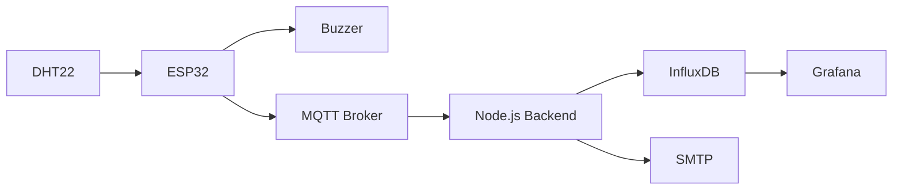

# IoT Environmental Monitoring

Sistema IoT completo para monitorar temperatura e umidade com ESP32/DHT22, alerta local por buzzer, MQTT, histórico InfluxDB, e-mail SMTP e dashboard Grafana provisionado.

## Objetivo

O firmware mede a cada aproximadamente cinco segundos. Acima de **37 °C** ou **70%**, o ESP32 aciona o buzzer imediatamente, sem depender da nuvem. O backend valida e recalcula o alerta, armazena o histórico, registra transições e impede spam de e-mail. Grafana mostra valores atuais, limites, séries históricas, status e eventos.

## Tecnologias

- ESP32 DevKit, DHT22, buzzer e Wokwi
- MQTT / Eclipse Mosquitto
- Node.js 22, MQTT.js, Nodemailer
- InfluxDB 2.7 e Grafana 11
- Docker Compose

## Arquitetura



Detalhes e decisões estão em [docs/architecture.md](docs/architecture.md).

## Estrutura

```text
.
├── wokwi/                 # firmware, circuito e configuração PlatformIO/Wokwi
├── backend/               # consumidor MQTT, InfluxDB, SMTP e testes unitários
├── infrastructure/
│   ├── mosquitto/         # configuração do broker local
│   └── grafana/           # datasource e dashboard provisionados
├── docs/                  # arquitetura, segurança e plano de testes
├── docker-compose.yml
├── Makefile
└── .env.example
```

## Início rápido

Requisitos: Docker com plugin Compose. Copie a configuração e altere pelo menos as senhas/token usados fora de uma demonstração local:

```bash
cp .env.example .env
docker compose up -d --build
docker compose ps
```

O primeiro start inicializa automaticamente organização, bucket e token do InfluxDB; provisiona o datasource e o dashboard Grafana; e inicia Mosquitto e backend. Não há configuração manual pelo navegador.

URLs:

- Grafana: <http://localhost:3000/d/iot-environmental-monitoring> (credenciais em `GRAFANA_ADMIN_*`)
- InfluxDB: <http://localhost:8086> (credenciais em `INFLUX_ADMIN_*`)
- MQTT local: `mqtt://localhost:1883`

Para acompanhar ingestão:

```bash
docker compose logs -f backend
```

## Conectar o Wokwi

As ligações já estão em `wokwi/diagram.json`: DHT22 VCC → 3V3, DATA → GPIO 15, GND → GND; buzzer 1 → GPIO 14 e 2 → GND.

Há duas formas de abrir:

1. Com PlatformIO e a extensão Wokwi para VS Code, abra `wokwi/`, execute `pio run` e o comando **Wokwi: Start Simulator**. `wokwi.toml` já aponta para firmware e ELF.
2. No site do Wokwi, crie um projeto ESP32 e importe o conteúdo de `sketch.ino`, `diagram.json` e `libraries.txt`.

O firmware usa `Wokwi-GUEST` e, para a demonstração online, `broker.hivemq.com:1883`. Para que o backend receba esses dados, ajuste no `.env`:

```env
MQTT_URL=mqtt://broker.hivemq.com:1883
```

Depois recrie somente o consumidor:

```bash
docker compose up -d --force-recreate backend
```

O broker público é compartilhado e sem TLS, portanto serve apenas para demonstração. A alternativa segura é configurar no `sketch.ino` e `.env` o mesmo broker cloud MQTTS (`8883`, TLS, usuário, senha e CA). Um Mosquitto local não é alcançável diretamente pelo Wokwi online; ele funciona com hardware/firmware local ou após exposição por túnel seguro. Veja [docs/security.md](docs/security.md).

## Provocar e observar alertas

Para preencher o Grafana com 72 horas de histórico realista antes da demonstração:

```bash
make seed
```

O gerador cria medições a cada cinco minutos e eventos de temperatura, umidade e ambos os limites. Ele grava diretamente no InfluxDB, portanto não envia e-mails históricos. Para personalizar a execução:

```bash
docker compose exec -T \
  -e SEED_HOURS=168 \
  -e SEED_INTERVAL_MINUTES=10 \
  backend npm run seed
```

No simulador, clique no DHT22:

- defina temperatura em `38` e umidade em `60` para `TEMPERATURE`;
- defina temperatura em `30` e umidade em `75` para `HUMIDITY`;
- defina `40` e `80` para `TEMPERATURE_AND_HUMIDITY`;
- retorne a `30` e `60` para desligar o buzzer e gerar `ALERT_RESOLVED`.

Espere até cinco segundos. O Serial mostra buzzer, leitura e publicação. No dashboard, selecione `esp32-01`; os gauges e históricos atualizam a cada cinco segundos, **System Status** muda de cor e **Alert Events** lista data, dispositivo, evento, motivo e valores.

Sem Wokwi, os mesmos cenários podem ser publicados no broker configurado:

```bash
make simulate     # normal, espera dois segundos e alerta de temperatura
make normal
make temperature
make recovery
make humidity
make recovery
make both
```

## E-mail

Preencha `SMTP_HOST`, `SMTP_PORT`, `SMTP_SECURE`, `SMTP_USER`, `SMTP_PASSWORD` e `ALERT_EMAIL_TO` no `.env`, então recrie o backend. Porta 587 normalmente usa `SMTP_SECURE=false` (STARTTLS); 465 normalmente usa `true`.

```bash
docker compose up -d --force-recreate backend
make normal
make temperature
docker compose logs backend
```

Confira `ALERT_EMAIL_TO` (inclusive spam) e o log `[EMAIL] Alert email sent`. Um alerta sustentado envia somente uma mensagem. `SEND_RECOVERY_EMAIL=true` habilita a mensagem após normalização.

## Testes e validação

```bash
cd backend
npm install
npm test
npm run check
cd ..
docker compose config --quiet
```

O roteiro funcional completo, incluindo payload inválido, antispam e defesa contra flags adulteradas, está em [docs/testing.md](docs/testing.md).

## Operação

```bash
make up       # inicia/reconstrói
make logs     # acompanha o backend
make validate # sintaxe, testes e Compose
make down     # encerra sem apagar volumes
```

`docker compose down -v` apaga definitivamente o histórico e deve ser usado somente quando essa remoção for intencional.
