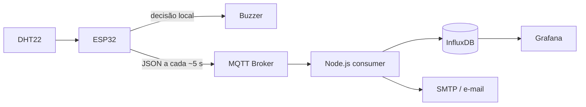

# Arquitetura

## Visão geral

O sistema separa a decisão crítica local do processamento centralizado. O ESP32 lê o DHT22 e aciona o buzzer antes de tentar publicar, portanto a proteção local continua funcionando sem Wi-Fi, MQTT, backend, banco ou internet.



## Edge

O ESP32 mede temperatura e umidade, valida valores não numéricos, calcula os limites `temperature > 37 || humidity > 70`, controla o buzzer e publica o payload. A tarefa do sensor usa `millis()`, sem um `delay(5000)` bloqueante. Wi-Fi e MQTT possuem tentativas periódicas de reconexão. O tópico de status usa Last Will (`offline`) e uma publicação retida (`online`).

## Comunicação MQTT

O tópico de dados é `iot/monitoring/esp32-01/vitals`; o backend assina `iot/monitoring/+/vitals`, permitindo mais dispositivos. `iot/monitoring/esp32-01/status` representa disponibilidade do dispositivo. QoS 1 é usado na assinatura do backend e no Last Will; as medições do firmware usam a publicação disponível no `PubSubClient`.

O Compose oferece Mosquitto local. Como o navegador do Wokwi não alcança `localhost` da máquina, o firmware vem configurado com um broker público somente para demonstração. Para unir o Wokwi online ao backend, ambos devem apontar para o mesmo broker público, cloud ou para um endpoint local publicado com túnel seguro.

## Backend e defesa em profundidade

O consumidor Node.js faz parse e validação estrita, ignora mensagens malformadas sem encerrar, aplica o timestamp do servidor e recalcula todos os booleanos de alerta. Flags inconsistentes do dispositivo são substituídas pelos valores calculados no backend.

A máquina de estados é mantida por `deviceId`:

```text
NORMAL -- limite excedido --> ALERT   (ALERT_STARTED + e-mail)
ALERT  -- ainda crítico ----> ALERT   (sem novo evento/e-mail)
ALERT  -- normalizou -------> NORMAL  (ALERT_RESOLVED + recuperação opcional)
```

Na primeira mensagem de cada dispositivo após iniciar, o serviço consulta o último status no InfluxDB. Isso evita novo e-mail após reinício durante um alerta já ativo. Se o banco estiver indisponível justamente nessa reconstrução, o serviço favorece disponibilidade e começa em `NORMAL`; essa contingência pode produzir uma notificação repetida. Em produção com alta disponibilidade, o estado deveria usar armazenamento transacional compartilhado.

## Persistência

InfluxDB é um banco NoSQL especializado em séries temporais e se encaixa naturalmente em `timestamp`, temperatura, umidade e dispositivo. `environment` preserva todas as medições; `alert_events` preserva apenas transições. A retenção padrão é ilimitada (`INFLUX_RETENTION=0`) e volumes Docker mantêm dados entre reinícios.

Embora MongoDB ofereça coleções time-series, InfluxDB reduz a complexidade da integração com Grafana e é mais diretamente alinhado ao desafio.

## Notificação e visualização

Nodemailer envia mensagem em texto e HTML por SMTP. Falhas SMTP são registradas e não interrompem ingestão. Grafana é a camada oficial de apresentação: gauges, históricos com linhas críticas, status e tabela de eventos são provisionados automaticamente e atualizam a cada cinco segundos.

Não há React, Angular ou Vue porque o próprio Grafana representa a camada de visualização solicitada. Uma segunda aplicação frontend adicionaria complexidade sem necessidade funcional.
